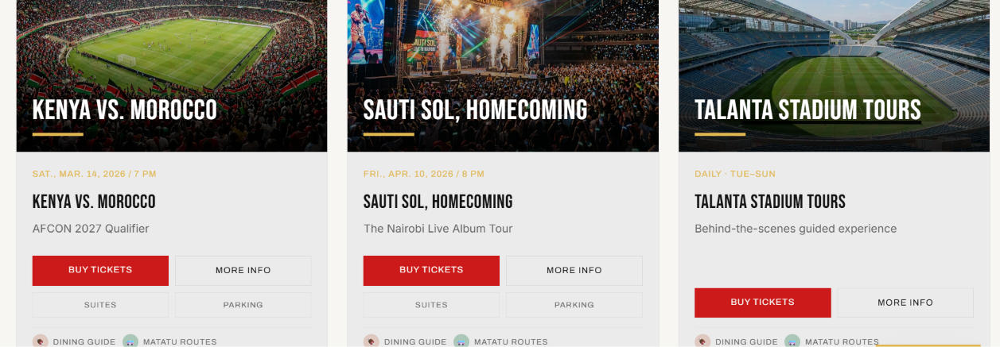

, Nairobi, Kenya  
**Proposing Firm**: ST-Tech ICT Consultants  
**Reference Directive**: Presidential Directive / Public Procurement Framework Context  
**Indicative Planning Envelope**: KES 75,000,000 (Preliminary; Subject to Detailed Site Survey & Bill of Quantities)  
**Proposed Timeline**: 10 Months (Post-Approval & Contract Execution)  

---

## Document Map & Page Alignment

| Core Proposal Section | PDF Page | Technical Annex Section | PDF Page |
| :--- | :---: | :--- | :---: |
| **1. Proposal Overview & Commercial Basis** | 4 | **26. Public Website Sitemap & Journeys** | 29 |
| **2. Document Control & Purpose** | 5 | **27. Seat Mapping & Inventory Rules** | 30 |
| **3. Executive Summary** | 6 | **28. API Design & Integration Contracts** | 31 |
| **4. Public-Sector Case & Alignment** | 7 | **29. Database, Audit Trail & Data Lifecycle** | 32 |
| **5. Venue Context & Scope Boundaries** | 8 | **30. Hosting, DevSecOps & Controls** | 33 |
| **6. Scope of Work & Deliverables** | 9 | **31. Event-Day Command Runbook** | 34 |
| **7. Public Website & Mobile Experience** | 10 | **32. Load Planning & Capacity Validation** | 35 |
| **8. Ticketing & Payment Workflow** | 11 | **33. Training, Service Desk & Warranty** | 36 |
| **9. High-Level System Architecture** | 12 | **34. Procurement Matrix & Change Control** | 37 |
| **10. Detailed Architecture & Environments** | 13 | **35. Commitments, Assumptions & Next Steps**| 38 |
| **11. Core Data Model & Entities** | 14 | | |
| **12. Gate Access & Crowd Operations** | 15 | | |
| **13. Identity & Optional Biometrics** | 16 | | |
| **14. Workforce & Accreditation** | 17 | | |
| **15. Command Dashboard & Reporting** | 18 | | |
| **16. Cybersecurity & Privacy Plan** | 19 | | |
| **17. Hosting, DR & Service Desk** | 20 | | |
| **18. Implementation Roadmap** | 21 | | |
| **19. Milestones & Acceptance Gates** | 22 | | |
| **20. QA & Go-Live Readiness** | 23 | | |
| **21. Project Team & Knowledge Transfer** | 24 | | |
| **22. Detailed Indicative Budget** | 25 | | |
| **23. Commercial Model & TCO** | 26 | | |
| **24. Benefits & Risk Register** | 27 | | |
| **25. Governance & Submission Checklist** | 28 | | |

---

<!-- PAGE 4 -->
## 1. Proposal Overview and Commercial Basis

**Target Venue**: Talanta Sports City / Talanta Stadium (60,000-Seat Capacity), Nairobi, Kenya  
**Proposed Client**: Ministry of Sports / Relevant Government Stadium Operating Authority  
**Proposing Entity**: ST-Tech ICT Consultants  
**Proposal Status**: Expanded Concept Proposal for Evaluation and Procurement Planning  
**Commercial Basis**: Indicative Planning Envelope (Preliminary; Non-Binding Quotation)  
**Reference Basis**: Presidential Directive / Public Procurement Framework Context  

### Executive Intent
This document presents a comprehensive, government-aligned technical and commercial proposal for an Integrated Smart Infrastructure System at Talanta Stadium. The proposed solution establishes an end-to-end digital operating framework encompassing public e-ticketing, secure payment gateways, gate validation, workforce accreditation, real-time command dashboards, and financial reconciliation.

> [!NOTE]
> **Status Disclaimer**: Prepared as an expanded concept proposal. No formal government endorsement, contract award, construction partnership, or live system deployment is implied. All technical scope, financial figures, integration interfaces, and performance statements remain subject to formal site survey, client verification, and public procurement procedures.

---

<!-- PAGE 5 -->
## 2. Document Control, Purpose and How to Use This Proposal

### Document Control Matrix
| Parameter | Position / Specification |
| :--- | :--- |
| **Document Title** | Integrated Talanta Stadium Smart Digital Infrastructure Technical & Financial Proposal |
| **Version Reference** | Expanded Concept Proposal – Final Polish & Review Draft |
| **Venue Context** | Talanta Sports City / Talanta Stadium, Nairobi, Kenya (60,000 Capacity) |
| **Proposer** | ST-Tech ICT Consultants (Authorised Representative & Technical Lead) |
| **Planning Envelope** | **KES 75,000,000** preliminary planning envelope carried forward from initial draft |
| **Implementation Period** | Indicative 10-month delivery roadmap post-contract execution and site access |
| **Required Approvals** | Client ICT, Venue Operations, Ministry of Finance, Office of the Data Protection Commissioner (ODPC), Communications Authority (CA), and Procurement Authorities |

### How to Navigate This Proposal
- **Pages 4–8 (Sections 1–5)**: Strategic case, public-sector alignment, construction context, and project boundaries.
- **Pages 9–14 (Sections 6–11)**: Scope of work, public web/mobile UX, payment workflows, system architecture, and core data models.
- **Pages 15–20 (Sections 12–17)**: Gate validation, biometric decision gates, workforce management, command centre dashboards, cybersecurity, and hosting/DR.
- **Pages 21–25 (Sections 18–22)**: 10-month implementation roadmap, milestone gates, QA protocols, project staffing, and itemised KES 75M indicative budget.
- **Pages 26–28 (Sections 23–25)**: Commercial terms, risk register, governance framework, verified context sources, and final submission checklist.
- **Pages 29–38 (Sections 26–35 - Technical Annex)**: Detailed sitemaps, inventory rules, API schemas, data lifecycles, DevSecOps pipelines, runbooks, and procurement evaluation matrices.

> [!IMPORTANT]
> **Concept Graphics Notice**: All visual mockups, architectural diagrams, and flowcharts presented in this document are illustrative concepts created to communicate system layout and functional relationships. They do not represent installed hardware, active software instances, or pre-approved branding.

---

<!-- PAGE 6 -->
## 3. Executive Summary

Talanta Stadium is a flagship national infrastructure project designed to anchor major regional and international sporting events. The opportunity proposed by ST-Tech ICT Consultants is to build a unified digital operating layer surrounding event discovery, ticket issuance, cashless payment processing, gate entry validation, staff accreditation, matchday command operations, and automated financial settlement.

The proposed **Integrated Talanta Stadium Digital Infrastructure (ITSDI)** utilizes a modular, micro-service-ready architecture. This enables the venue operator to deploy core ticketing, payment, and gate validation systems first, followed by incremental integration of advanced workforce, accreditation, and analytical modules once operational baseline stability is verified.

```
+-----------------------------------------------------------------------------------+
|                        TALANTA DIGITAL OPERATING LAYER                            |
+--------------------------+--------------------------+-----------------------------+
|    PUBLIC EXPERIENCE     |    VENUE OPERATIONS      |     GOVERNANCE & TRUST      |
|  * Web & Mobile Portal   * Gate Validation Scanners  * M-PESA Reconciliation       |
|  * Cashless Checkout     * Workforce Accreditation  * Role-Based Audit Logging    |
|  * Digital Ticket Wallet * Real-Time Dashboards     * Data Protection Act Compl.  |
+--------------------------+--------------------------+-----------------------------+
```

### Core Outcomes Proposed
1. **Official Public Channel**: Unified mobile-first web portal for fixture discovery, ticket purchasing, matchday instructions, and customer service.
2. **Financial Integrity & Settlement**: Real-time M-PESA and card transaction verification, automated refund handling, and event-level revenue reconciliation.
3. **High-Throughput Gate Control**: Rapid ticket validation workflows backed by offline cached contingency rules and supervisor exception handling.
4. **Workforce & Accreditation Management**: Centralised role-based credentialing, shift scheduling, vendor attendance tracking, and zone access control.
5. **Unified Command Centre**: Real-time operational dashboards providing attendance counts, gate health metrics, queue warnings, and incident tracking.
6. **Privacy & Security by Design**: Strict compliance with Kenya's Data Protection Act 2019, TLS/AES encryption, MFA for administration, and full auditability.

### Formal Decision Sought
Approve a formal **Discovery & Feasibility Phase** to validate venue site readiness, existing infrastructure interfaces, network cabling, power distribution, data protection parameters, and public procurement requirements prior to finalizing a binding contract.

---

<!-- PAGE 7 -->
## 4. Public-Sector Case and Strategic Alignment

A government-grade digital infrastructure proposal must deliver tangible public value, financial accountability, and operational efficiency. The ITSDI platform directly aligns with national digital transformation priorities and stadium management objectives.

### Strategic Value Matrix
| Public Sector Objective | Proposed System Contribution | Target Evidence / KPI |
| :--- | :--- | :--- |
| **Financial Accountability** | Fully traceable transaction logs, automated M-PESA reconciliation, and audit-ready revenue reports per event. | Signed event reconciliation statement within 24 hours of match closeout. |
| **Safer Event Flow** | Live gate validation rates, density heatmaps, queue bottleneck alerts, and structured incident escalation workflows. | Median gate throughput <2.5 seconds; zero unhandled turnstile queues. |
| **Convenient Public Service** | Mobile-optimised booking, instant digital ticket delivery, self-service recovery, and accessible seating allocations. | >90% checkout completion rate; customer support response <5 mins. |
| **Operational Efficiency** | Automated roster scheduling, zone-specific accreditation, shift timekeeping, and vendor invoice verification. | <2% variance between scheduled staff shifts and vendor billing claims. |
| **Local Capability & Skills Transfer** | Comprehensive technical training, operational runbooks, administrator handover, and ongoing local IT support. | 100% pass rate on operator competency evaluations prior to go-live. |
| **Privacy & Digital Trust** | Data minimisation, clear privacy notices, role-based access restrictions, and strict retention schedules. | Zero non-compliant data disclosures; completed Data Protection Impact Assessment (DPIA). |

> [!WARNING]
> **Baseline Data Requirement**: System performance improvements and risk reductions must be measured against verified venue baseline metrics established during the Discovery Phase.

---

<!-- PAGE 8 -->
## 5. Venue Context, Construction Background and Scope Boundaries

### Construction & Stakeholder Context
Publicly available reporting confirms that China Road and Bridge Corporation (CRBC) is the main engineering contractor for Talanta Sports City, with technical supervision and project execution oversight provided by the Kenya Defence Forces (KDF) Engineering Department. Architectural and design consultancies have been associated with University of Nairobi Enterprises and Services Limited (UNES) under Prof. Erastus Abonyo.

Construction officially commenced in March 2024. A CRBC project update dated 10 February 2026 targeted substantial civil completion by late Q1 2026. The actual current status of structural handover, power connection, and site readiness must be formally confirmed with venue authorities before physical installation begins.

```
+-----------------------------------------------------------------------------------+
|                            PROJECT BOUNDARY DEFINITION                            |
+-----------------------------------------------------------------------------------+
|  [ IN SCOPE: DIGITAL OPERATING LAYER ]   |  [ OUT OF SCOPE / HARDWARE DEPENDENCY ]|
|  * Public Web & Mobile Applications       |  * Civil Engineering & Construction    |
|  * Payment Gateway & API Integration     |  * Turnstile Gates & Barrier Hardware   |
|  * Validation Software & Scanner Apps    |  * Optical Cameras & Physical CCTV     |
|  * Workforce & Accreditation Software    |  * Network Switches, Fiber & Power UPS  |
|  * Central Command Dashboards            |  * Stadium Video Displays & PA Hardware |
+------------------------------------------+----------------------------------------+
```

### Digital Project Boundaries
- **Core Focus**: Software platform, API integration layer, mobile scanner applications, data management, and operational dashboards.
- **Physical Hardware**: Turnstile barriers, CCTV cameras, servers, network cabling, access gates, and power systems require independent procurement or integration with existing venue contracts.
- **Third-Party Approval**: Integrations with external payment providers (Safaricom M-PESA) or government identity registers require formal legal authorization and technical interface documentation.

---

<!-- PAGE 9 -->
## 6. Scope of Work and Deliverables

The proposed implementation is structured into eight core workstreams, ensuring full coverage from requirements gathering to post-launch hypercare.

### Deliverables Matrix
| Workstream | Included Scope & Technical Capabilities | Key Deliverable / Acceptance Target |
| :--- | :--- | :--- |
| **1. Discovery & Design** | Requirements workshops, site surveys, network audit, system mapping, risk register, and data flow design. | Signed Requirements Baseline & Solution Architecture Pack. |
| **2. Public Ticketing** | Fixture management, tiered seat maps, order engine, ticket wallet, e-receipts, and refund workflows. | Tested Public Web Application & Admin Portal. |
| **3. Payments** | Safaricom M-PESA Daraja integration, card payment gateway, idempotency handling, and automated reconciliation. | Sandbox Verification Report & Payment Audit Checklist. |
| **4. Gate Validation** | Validation APIs, mobile scanner software, offline caching protocol, exception queues, and stewards app. | Validation Test Report on target mobile/gate devices. |
| **5. Workforce** | Staff/contractor database, role accreditation, zone access control, shift scheduling, and attendance logs. | Operational Workforce Portal & Exportable Roster Reports. |
| **6. Command Dashboard** | Real-time matchday dashboard, scan metrics, gate health indicators, incident management, and financial summaries. | Role-Based Command Consoles & Audit Log Exporters. |
| **7. Security & Privacy** | Threat modeling, Data Protection Impact Assessment (DPIA), TLS/AES encryption, MFA, and penetration testing. | Security Assessment Report & ODPC Compliance Sign-off. |
| **8. Training & Handover** | Role-tailored training modules, operational runbooks, system manuals, disaster recovery drills, and hypercare. | Signed Training Attendance & Technical Handover Certificate. |

---

<!-- PAGE 10 -->
## 7. Public Website and Mobile Experience

The public web and mobile portal serves as the primary digital touchpoint for stadium patrons, offering a secure, accessible, and fast-loading experience across mobile networks.

```
+-----------------------------------------------------------------------------------+
|                     PROPOSED PUBLIC WEB & MOBILE UX MOCKUP                        |
+-----------------------------------------------------------------------------------+
| [ Header: TALANTA LIVE | Fixtures | Tickets | Venue Guide | Accessibility ]      |
|                                                                                   |
|  TALANTA SPORTS CITY, NAIROBI                                                     |
|  "Your Matchday. Seamlessly Connected."                                           |
|  [ Explore Fixtures -> ]   [ Buy Tickets -> ]                                     |
|                                                                                   |
|  +-----------------------+ +-----------------------+ +-------------------------+  |
|  | SECURE TICKETS        | | M-PESA CHECKOUT       | | ACCESSIBLE MATCHDAY     |  |
|  | Dynamic QR Codes      | | Instant STK Push      | | Wheelchair Seats      |  |
|  | Instant Delivery      | | Fraud Prevention      | | Step-Free Route Maps  |  |
|  +-----------------------+ +-----------------------+ +-------------------------+  |
+-----------------------------------------------------------------------------------+
```

### Core User Journeys
1. **Home & Fixture Discovery**: Official notices, upcoming match details, venue guidelines, and service status alerts.
2. **Event Selection & Booking**: Interactive zone/seat selection, transparent pricing breakdowns, accessible seating options, and countdown hold timers.
3. **Cashless Checkout**: Seamless M-PESA STK Push prompt, card payment options, instant transaction verification, and downloadable PDF/digital wallet tickets.
4. **Digital Ticket Wallet**: Secure dynamic QR codes, offline ticket view capability, ticket transfer controls, and self-service support.
5. **Help & Customer Care**: Frequently asked questions, refund policies, lost ticket recovery, accessibility assistance, and contact forms.

### Design & Accessibility Standards
- **Compliance**: Target WCAG 2.2 Level AA accessibility compliance.
- **Performance**: Mobile-first responsive layout optimised for 3G/4G network speeds across Kenya.
- **Inclusivity**: Screen reader compatibility, high-contrast visual modes, keyboard navigation, and plain-language matchday instructions.

---

<!-- PAGE 11 -->
## 8. Ticketing and Payment Workflow

To guarantee financial integrity and prevent fraudulent ticket generation, payment confirmation and ticket issuance are strictly decoupled and executed asynchronously.

```
+-----------------------------------------------------------------------------------+
|                        TICKET PURCHASE TO ENTRY LIFECYCLE                         |
+-----------------------------------------------------------------------------------+
| 1. DISCOVER  --->  2. SELECT   --->  3. PAY      --->  4. RECEIVE  ---> 5. VALIDATE |
| View Match        Choose Seat        M-PESA /          Digital          Gate Scan |
| & Rules           & Category         Card Payment      Ticket & Ref     at Stadium|
+-----------------------------------------------------------------------------------+
```

### Order State Machine
| Order State | System Action | Control Safeguard |
| :--- | :--- | :--- |
| **Draft Order** | Holds selected seat/zone inventory for a configurable time window (e.g., 10 mins). | Automated release of expired cart holds; concurrency locking. |
| **Payment Pending** | Generates payment reference, triggers M-PESA STK Push, and awaits callback. | Idempotency key tracking; safe background status polling. |
| **Paid / Confirmed** | Validates gateway digital signature, marks order paid, and issues signed ticket QR. | Cryptographic signature verification; immutable order log. |
| **Failed / Expired** | Releases held inventory back to public pool; displays clear user error prompt. | Duplicate charge prevention; automatic retry limits. |
| **Refunded / Cancelled**| Revokes associated ticket credentials; logs approval authority and refund ID. | Two-factor approval for refunds; automated reconciliation update. |

---

<!-- PAGE 12 -->
## 9. High-Level System Architecture

The ITSDI platform employs a modern multi-tier architecture designed for high availability, fast response times, and security.

```
+-----------------------------------------------------------------------------------+
|                        PROPOSED PLATFORM ARCHITECTURE                             |
+-----------------------------------------------------------------------------------+
| [ PUBLIC CHANNELS ]   Browser Web | Mobile Web | SMS Alerts                       |
|         |                                                                         |
| [ SECURE API LAYER ]  Authentication | Rate Limiting | WAF | Audit Hook           |
|         |                                                                         |
| [ CORE SERVICES ]     Ticketing | M-PESA Payments | Workforce | Reporting Engine |
|         |                                                                         |
| [ VENUE EDGE ]        Local Gate Validation Cache | Offline Synch Engine          |
|         |                                                                         |
| [ DATA & SECURITY ]   Encrypted Relational DB | Secret Vault | Cold Backups       |
+-----------------------------------------------------------------------------------+
```

### Architectural Principles
- **Public Channels**: Responsive web application accessible on all modern smartphone browsers without mandatory app store downloads.
- **Secure API Gateway**: Centralized management of authentication, API rate limits, web application firewalling (WAF), and request logging.
- **Core Micro-Services**: Modular business logic separated into distinct domain services (Orders, Payments, Validation, Accreditation).
- **Venue Edge Node**: Local on-site edge server caching active ticket validation keys to maintain gate operation during internet outages.

---

<!-- PAGE 13 -->
## 10. Detailed Architecture, Data Flow and Environments

### System Tier Breakdown
| Architectural Tier | Responsibilities & Capabilities | Key Design Control |
| :--- | :--- | :--- |
| **Experience Layer** | Public web portal, stewards mobile app, staff portal, command console. | Secure session tokens, responsive layouts, HTTPS enforce. |
| **Application / API Tier**| Order engine, ticket inventory, payment handling, accreditation logic. | Versioned REST APIs, strict schema validation, idempotency. |
| **Integration Tier** | M-PESA Daraja adapter, SMS gateway, email dispatch, gate scanner APIs. | Asynchronous message queues, retry backoff, timeout handling. |
| **Persistence Tier** | PostgreSQL database, Redis session cache, encrypted backup storage. | Encrypted at rest (AES-256), automated daily snapshots. |
| **Operations Tier** | Prometheus/Grafana monitoring, centralized logging, DevSecOps pipeline. | Role-based access, automated vulnerability scanning. |

### Deployment Environments
1. **Development**: Isolated sandbox utilizing synthetic test data for feature development.
2. **Staging / Test**: Production-mirror environment connected to M-PESA sandbox for load testing and UAT.
3. **Production**: Highly available multi-zone cloud/data-centre deployment with strict access restrictions.
4. **Training**: Dedicated non-production environment configured for staff onboarding and matchday rehearsals.

---

<!-- PAGE 14 -->
## 11. Core Data Model and System Entities

A standardized relational data model prevents ticket duplication, inventory overselling, and financial discrepancies.

### Primary Data Entities
| Entity Name | Key Attributes & Relationships | Essential Governance Safeguards |
| :--- | :--- | :--- |
| **Event** | `Event_ID`, `Title`, `Venue_Zone`, `Start_Time`, `Status`, `Entry_Rules`. | Published state locked; full administrative edit trail. |
| **Ticket Inventory** | `Inventory_ID`, `Event_ID`, `Category_Code`, `Seat_ID`, `Price`, `Hold_Status`. | Transactional locking prevents double booking under high load. |
| **Order / Payment** | `Order_ID`, `User_Ref`, `Amount`, `Mpesa_Receipt`, `Status`, `Timestamp`. | Idempotent transaction processing; immutable audit record. |
| **Ticket** | `Ticket_ID`, `Order_ID`, `Cryptographic_Token`, `Validation_Status`, `Scan_Time`. | Single-use validation constraint; dynamic anti-replay token. |
| **User Account** | `User_ID`, `Role_Permissions`, `MFA_Secret`, `Phone_Encrypted`, `Status`. | Least-privilege role assignment; privileged action logging. |
| **Accreditation** | `Accred_ID`, `Person_Name`, `Organisation`, `Zone_Permissions`, `Expiry`. | Time-bounded validity; supervisor sign-off requirements. |
| **Audit Log** | `Log_ID`, `Actor_ID`, `Action_Type`, `Entity_Affected`, `IP_Address`, `Timestamp`. | Write-once append-only storage; immutable security logging. |
| **Device / Gate** | `Device_ID`, `Gate_Location`, `Heartbeat_Time`, `Firmware_Ver`, `Status`. | Certificate-based device authentication; rate limiting. |

---

<!-- PAGE 15 -->
## 12. Gate Access, Ticket Validation and Crowd Operations

Gate entry validation must combine speed, security, and operational reliability to handle peak crowd arrivals safely.

```
+-----------------------------------------------------------------------------------+
|                        SCANNER VALIDATION & EXCEPTION FLOW                        |
+-----------------------------------------------------------------------------------+
| [ SCAN CREDENTIAL ] ---> [ DECRYPT TOKEN ] ---> [ CHECK STATUS & ENTRY WINDOW ]   |
|                                                                |                  |
|                        +---------------------------------------+                  |
|                        |                                       |                  |
|               [ VALID / APPROVED ]                    [ INVALID / REJECTED ]      |
|                        |                                       |                  |
|            Display Green Light & Audio              Display Red Light & Route to  |
|            Record Gate Entry Timestamp              Supervisor Exception Queue    |
+-----------------------------------------------------------------------------------+
```

### Validation Sequence
1. **Token Reading**: Scanner reads optical QR or NFC credential presented by fan.
2. **Cryptographic Check**: Local scanner verifies cryptographic signature using edge public key.
3. **Business Logic Check**: Validates event ID, entry window, gate zone eligibility, and revocation list.
4. **Entry Logging**: Records successful scan timestamp, device ID, and updates ticket status to 'USED'.
5. **Exception Handling**: Invalid, expired, or previously scanned tickets route the patron to a dedicated supervisor kiosk.
6. **Offline Operation**: In the event of network disconnection, scanners switch to local edge cache validation, syncing logs automatically upon re-connection.

> [!CAUTION]
> **Life Safety Priority**: Digital access systems strictly serve access control and must never impair physical emergency egress. All turnstiles and gates must incorporate hardware-level fail-safe mechanical overrides compliant with national safety standards.

---

<!-- PAGE 16 -->
## 13. Identity Verification and Optional Biometrics

Biometric facial recognition is presented strictly as an **optional, advanced capability** requiring formal government approval, explicit legal basis, and thorough privacy assessments before implementation.

```
+-----------------------------------------------------------------------------------+
|                     SECURITY & PRIVACY BY DESIGN FRAMEWORK                        |
+-----------------------------------------------------------------------------------+
| 1. GOVERNANCE          * Lawful Basis * DPIA Assessment * Legal Approval          |
| 2. IDENTITY CONTROL    * Role-Based Access * MFA * Least Privilege Principle      |
| 3. PLATFORM DEFENCES   * TLS Encryption * WAF * Dependency Vulnerability Checks     |
| 4. RESILIENCE          * Daily Encrypted Backups * Penetration Testing * Failover |
| 5. OVERSIGHT           * Immutable Audit Logs * Retention Rules * Operator Drill  |
+-----------------------------------------------------------------------------------+
```

### Mandatory Decision Gates for Biometrics
1. **Legal & Regulatory Clearance**: Obtain formal sign-off from the Office of the Data Protection Commissioner (ODPC).
2. **Necessity & Proportionality Test**: Demonstrate that standard QR/NFC digital ticketing is insufficient for high-security areas.
3. **Data Protection Impact Assessment (DPIA)**: Document complete biometric template hashing, storage limits, and encryption protocols.
4. **Explicit Consent & Alternatives**: Guarantee non-biometric entry alternatives for all patrons and staff without penalty.
5. **Strict Purpose Limitation**: Prohibit the use of biometric data for general surveillance or third-party sharing.

---

<!-- PAGE 17 -->
## 14. Staff, Contractor and Accreditation Management

The workforce module coordinates internal stadium staff, security personnel, contractors, catering vendors, media, and VIP guests.

### Workforce Capabilities
| Capability | Operational Workflow | Administrative Control |
| :--- | :--- | :--- |
| **Onboarding** | Registers staff profile, vendor details, identity verification, and role request. | Mandatory supervisor sign-off; minimum data collection. |
| **Shift Planning** | Assigns personnel to matchday shifts, specific gate zones, and duty supervisors. | Automated conflict detection; roster change logging. |
| **Credential Issuance**| Generates digital or printed accreditation passes with zone-coded access rights. | Time-bounded validity; instant remote revocation capability. |
| **Attendance Tracking**| Logs shift check-in and check-out times via mobile scanner or supervisor portal. | Supervisor review required before payroll file export. |
| **Vendor Management**| Validates third-party vendor rosters against actual on-site check-in logs. | Audit log generation for contract compliance verification. |
| **Offboarding** | Automatically expires credentials and revokes portal access upon shift completion. | Automated access teardown; credential deactivation. |

---

<!-- PAGE 18 -->
## 15. Command Centre, Dashboards and Reporting

The matchday command centre provides real-time operational visibility through role-tailored reporting consoles.

### Role-Specific Dashboards
| Dashboard View | Primary Information Displayed | Authorised Users |
| :--- | :--- | :--- |
| **Event Overview** | Real-time entry totals, turnstile scan rate, venue fill rate, active alerts. | Venue Commander, Operations Director. |
| **Gate Operations** | Gate-by-gate scan velocity, rejection rates, device battery/network health. | Gate Supervisors, Technical Support. |
| **Financial Settlement**| Real-time tickets sold, M-PESA revenue collected, pending orders, refund logs. | Finance Lead, Internal Auditor. |
| **Workforce Console**| Staff check-in counts, zone coverage percentages, unstaffed position alerts. | HR Lead, Security Manager. |
| **Security & Incidents**| Logged incident locations, supervisor escalation status, gate exception queues. | Chief Security Officer, Police Liaison. |
| **Technical Health** | API latency, server CPU/memory load, M-PESA callback queue depth, error logs. | ICT Platform Lead, Systems Engineer. |

---

<!-- PAGE 19 -->
## 16. Cybersecurity, Privacy and Compliance Plan

Security and data privacy are embedded into every layer of the platform architecture in compliance with Kenyan laws and global standards.

### Security Controls Matrix
| Domain | Technical Implementation | Compliance Evidence |
| :--- | :--- | :--- |
| **Identity & Access** | Role-based access control (RBAC), multi-factor authentication (MFA) for administrative access. | Access review audit logs; RBAC policy file. |
| **Data Encryption** | TLS 1.3 for data in transit; AES-256 encryption at rest for databases and backups. | SSL Labs A+ rating; DB configuration review. |
| **Secure SDLC** | Automated static code analysis, dependency vulnerability scanning, secrets detection. | CI/CD build pipeline security scan logs. |
| **Security Monitoring**| Centralized log aggregation, real-time alert triggers, continuous health monitoring. | Security Incident Event Management (SIEM) logs. |
| **System Resilience** | Encrypted daily offsite backups, disaster recovery failover procedures, regular restore drills. | Backup restore drill test report. |
| **Penetration Testing**| Independent third-party penetration testing and vulnerability remediation prior to go-live. | Executed Penetration Test Report & Remediation Log. |
| **Privacy Compliance**| Full compliance with Kenya Data Protection Act 2019; explicit user consent prompts. | Published Privacy Notice & Registered DPIA. |

---

<!-- PAGE 20 -->
## 17. Hosting, Availability, Disaster Recovery and Support

### Operational Architecture
| Operational Domain | Recommended Technical Approach | Decision Parameter |
| :--- | :--- | :--- |
| **Hosting Infrastructure** | High-availability cloud or Tier-3 government data centre with redundant power/network. | Data residency policy & recurring hosting costs. |
| **Backup Management** | Automated hourly database snapshots and daily encrypted offsite backups. | Recovery Point Objective (RPO) <15 minutes. |
| **Disaster Recovery** | Hot-standby secondary environment with automated failover routing. | Recovery Time Objective (RTO) <1 hour. |
| **Offline Gate Entry** | Local edge cache at stadium gates permitting continuous validation during link outages. | Local storage security & post-event sync rules. |
| **24/7 Monitoring** | Automated infrastructure health alerts, synthetic transaction checks, queue depth monitoring.| Escalation rota & incident notification paths. |

### Service Level Agreement (SLA) Framework
- **Critical Severity (P1)**: Target acknowledgement <15 mins; continuous engineering resolution until fixed.
- **High Severity (P2)**: Target acknowledgement <30 mins; workaround within 2 hours.
- **Routine Requests (P3/P4)**: Handled within standard business business hours.

---

<!-- PAGE 21 -->
## 18. Implementation Roadmap and Duration by Part

The project is structured across seven phases spanning an estimated **10-month delivery timeline**.

```
+-----------------------------------------------------------------------------------+
|                        10-MONTH IMPLEMENTATION ROADMAP                            |
+-----------------------------------------------------------------------------------+
| Phase 1: Discovery & Baseline        [M1]                                         |
| Phase 2: Architecture & Design       [M2]                                         |
| Phase 3: Core Platform Build               [M3 ---------- M5]                     |
| Phase 4: Integrations & Payments                 [M6 ---- M7]                     |
| Phase 5: Pilot Testing & QA                            [M8]                       |
| Phase 6: Production Deployment                              [M9]                  |
| Phase 7: Go-Live & Hypercare                                     [M10+]           |
+-----------------------------------------------------------------------------------+
```

### Phase Schedule
| Phase Reference | Target Duration | Key Activities & Scope | Phase Gate Deliverable |
| :--- | :---: | :--- | :--- |
| **Phase 1: Discovery** | 4 Weeks | Stakeholder workshops, site survey, system audit, requirements baseline. | Signed Scope & Requirements Baseline. |
| **Phase 2: Design** | 4 Weeks | UX prototypes, API contracts, database schema, DPIA submission. | Approved Solution Architecture Pack. |
| **Phase 3: Core Build**| 12 Weeks| Public portal, order engine, admin console, workforce software. | Core System Staging Release. |
| **Phase 4: Integrations**| 8 Weeks | M-PESA gateway integration, gate scanner app, SMS notifications. | Interface Testing Verification Report. |
| **Phase 5: Pilot & QA**| 4 Weeks | User acceptance testing, load testing, security pen tests, operational drills. | UAT Sign-off & Security Audit Closure. |
| **Phase 6: Deployment**| 4 Weeks | Production environment setup, operational staff training, rehearsal match. | Signed Go-Live Readiness Certificate. |
| **Phase 7: Hypercare** | 4 Weeks | On-site matchday support, performance tuning, final documentation handover. | Final Handover Sign-off & Support Transition.|

---

<!-- PAGE 22 -->
## 19. Milestones, Dependencies and Acceptance Gates

### Project Milestone Schedule
| Target Milestone | Core Deliverable / Output | Client / External Dependency |
| :--- | :--- | :--- |
| **End Month 1** | Discovery Report, Network Audit, Requirements Document. | Access to venue site, drawings, and key stakeholders. |
| **End Month 2** | Approved System Design, Data Schemas, DPIA Document. | Legal, ICT, and Data Protection review sign-off. |
| **End Month 5** | Core Ticketing, Orders, and Admin Portal in Staging. | Approved fixture schedule, ticket pricing rules. |
| **End Month 7** | M-PESA Payment Integration and Mobile Scanner App Beta. | Safaricom production API credentials & scanner devices. |
| **End Month 8** | Completed UAT, Penetration Test Report, Load Test Results.| Designated test users and venue test environment. |
| **End Month 9** | Production System Live, Operator Training Completed. | Formal venue handover and site power/network readiness. |
| **Month 10+** | Successful Matchday Go-Live & Technical Handover. | Designated operational staff for takeover. |

---

<!-- PAGE 23 -->
## 20. Testing, Quality Assurance and Go-Live Readiness

A rigorous, multi-tiered testing strategy guarantees platform reliability, speed, and security prior to public release.

### QA Testing Streams
| Test Stream | Scope of Testing | Exit Criteria / Acceptance Target |
| :--- | :--- | :--- |
| **Functional Testing** | End-to-end order flows, ticket issuance, cancellation, refunding, role permissions. | 100% pass rate on core test scenarios. |
| **Payment Testing** | M-PESA STK Push, payment callbacks, duplicate transactions, timeout recovery. | Verified zero financial reconciliation discrepancies. |
| **Load & Performance**| Simulated peak traffic (10,000 concurrent web users; 500 scans/minute). | Web response <1.5s; Gate API latency <200ms. |
| **Security Testing** | Vulnerability scanning, penetration testing, OWASP Top 10, privilege escalation. | Remediation of all Critical/High vulnerability findings. |
| **Accessibility** | Screen reader navigation, keyboard accessibility, mobile viewport responsiveness. | WCAG 2.2 AA verification report. |
| **Disaster Recovery** | Network outage simulation, database failover, edge validation sync. | Successful recovery drill meeting RTO/RPO targets. |
| **Operational Drill**| Full matchday simulation with stewards, gate supervisors, and command operators.| Signed Operational Readiness Review. |

---

<!-- PAGE 24 -->
## 21. Project Team, Responsibilities and Knowledge Transfer

### Supplier Team Structure
| Proposed Role | Responsibilities & Focus | Project Phase Engagement |
| :--- | :--- | :--- |
| **Delivery Project Manager** | Overall project governance, timeline tracking, risk management, client reporting. | Phases 1–7 (Full Lifecycle) |
| **Solution Architect** | Technical design, system integrity, API contracts, security architecture. | Phases 1–6 |
| **Senior Full-Stack Engineers**| Frontend portal development, backend order engine, admin consoles, API build. | Phases 2–6 |
| **Integration Specialist** | M-PESA integration, gateway adapters, scanner app synchronization. | Phases 3–5 |
| **QA & Performance Lead** | Test automation, load testing, user acceptance coordination, bug tracking. | Phases 3–6 |
| **Cybersecurity Specialist** | Threat modeling, security hardening, penetration test oversight, DPIA support. | Phases 2, 5, 6 |
| **DevOps Engineer** | CI/CD pipeline setup, cloud infrastructure, database cluster, monitoring. | Phases 2–7 |
| **Training & Support Lead** | Documentation, operational runbooks, user training sessions, matchday support. | Phases 5–7 |

### Knowledge Transfer Program
1. **System Documentation**: Complete architecture blueprints, database schemas, and API specifications.
2. **Operational Runbooks**: Step-by-step guides for matchday setup, gate monitoring, and incident response.
3. **Hands-on Training**: Interactive training workshops for administrators, stewards, finance staff, and ICT personnel.

---

<!-- PAGE 25 -->
## 22. Detailed Indicative Budget and Cost Basis

The supplied proposal's **KES 75,000,000** planning envelope is retained as a preliminary budget estimate.

### Itemised Budget Breakdown
| Item No. | Work Package / Deliverable Module | Indicative Amount (KES) | Technical Cost Basis & Inclusions |
| :---: | :--- | :---: | :--- |
| **1** | Public Ticketing Web Portal & Mobile UX | **18,500,000** | Web application, booking engine, ticket wallet, e-receipts, admin portal. |
| **2** | Access Validation & Identity Integration | **14,000,000** | Scanner app software, validation API engine, edge caching module. |
| **3** | Staff & Contractor Accreditation System | **8,500,000** | Workforce portal, role/zone credentialing engine, roster tracking. |
| **4** | Command Centre Dashboards & Analytics | **7,000,000** | Real-time matchday console, gate health monitoring, revenue reports. |
| **5** | Cybersecurity & Privacy Assurance | **4,500,000** | Security hardening, penetration testing, DPIA execution support. |
| **6** | Device Middleware & System Interfaces | **9,500,000** | M-PESA gateway adapter, SMS gateway integration, scanner APIs. |
| **7** | Training, Documentation & Handover | **3,500,000** | Manuals, operational runbooks, administrator training, hypercare. |
| **SUB** | **Indicative Engineering Subtotal** | **65,500,000** | **Software Engineering, Integration & Delivery Subtotal** |
| **8** | First-Year Hosting, SLA & Support Allowance| **9,500,000** | High-availability cloud infrastructure, monitoring, 24/7 matchday SLA. |
| **TOTAL**| **Indicative Total Planning Envelope** | **KES 75,000,000**| **Preliminary Planning Budget (Subject to Scope Verification)** |

> [!IMPORTANT]
> **Cost Basis Disclaimers**: The KES 75M total represents a conceptual planning estimate. It excludes physical turnstile hardware, CCTV cameras, network cabling, site civil works, SMS broadcast charges, payment gateway transaction fees, and government taxes unless explicitly contracted.

---

<!-- PAGE 26 -->
## 23. Commercial Model, Payment Milestones and Total Cost of Ownership

### Payment Milestone Schedule
| Milestone | Fee Share | Delivery & Acceptance Trigger |
| :---: | :---: | :--- |
| **M1: Mobilisation** | **10%** | Contract execution, approved project charter, inception report sign-off. |
| **M2: Design Sign-off** | **15%** | Approved Solution Architecture Pack, DPIA clearance, SRS document sign-off. |
| **M3: Core Staging** | **25%** | Functional core portal, order engine, and admin console deployed to staging. |
| **M4: Integrations** | **20%** | Verified M-PESA integration, scanner validation API, UAT report sign-off. |
| **M5: Deployment** | **20%** | Production environment live, penetration test closed, staff training completed.|
| **M6: Handover** | **10%** | Successful matchday go-live, complete documentation handover sign-off. |

---

<!-- PAGE 27 -->
## 24. Benefits Measurement, Risk Register and Mitigation

### Risk Management Register
| Risk Description | Severity | Proposed Mitigation Strategy | Risk Owner |
| :--- | :---: | :--- | :--- |
| **Unclear External Interfaces** | High | Conduct discovery audit early; build mock integration adapters. | Lead Architect |
| **Data Privacy / ODPC Challenge** | High | Strict data minimisation; complete DPIA before pilot release. | Privacy Specialist |
| **Payment Callback Mismatches** | Medium | Implement idempotent callback handling and daily reconciliation. | Integration Lead |
| **Network / Power Interruption**| High | Deploy local edge validation servers with offline cached keys. | DevOps Engineer |
| **Scope Expansion / Overrun** | Medium | Maintain strict change control governance; documented baselines. | Project Manager |
| **User Adoption Resistance** | Medium | Deliver intuitive mobile UX; conduct comprehensive steward training. | Training Lead |

---

<!-- PAGE 28 -->
## 25. Governance, Acceptance, Sources and Final Submission Checklist

### Governance Accountability Framework
| Stakeholder Group | Primary Role & Governance Accountability |
| :--- | :--- |
| **Ministry / Venue Sponsor** | Project funding, high-level governance, contract approval, final acceptance. |
| **Stadium Operations Team** | Matchday requirements validation, gate procedures sign-off, operational UAT. |
| **Client ICT & Security** | Architecture review, cybersecurity compliance, infrastructure access. |
| **Data Protection Officer (DPO)**| Privacy policy review, DPIA approval, regulatory compliance monitoring. |
| **ST-Tech ICT Consultants** | System design, software development, API integration, testing, handover. |

### Verified Context Sources
- **China Road and Bridge Corporation (CRBC)**: [Project Update - Talanta Sports City Progress](https://www.crbc.com/site/crbcEN/381/info/2026/46885286.html) (10 February 2026).
- **Office of the President of Kenya**: [Presidential Site Inspection Report](https://www.president.go.ke/president-ruto-inspects-construction-progress-at-talanta-sports-city/) (11 April 2025).

---

# TECHNICAL ANNEX
### Detailed Engineering, Operational & Procurement Specifications

---

<!-- PAGE 29 -->
## 26. Detailed Public Website Sitemap and User Journeys

| Page / Section | Core Functional Features | Acceptance Verification Criteria |
| :--- | :--- | :--- |
| **Home Page** | Banner notices, fixture schedules, venue guide links, support contact. | Mobile responsive; <1.5s load time. |
| **Events Page** | Filterable match listings, date pickers, ticket availability indicators. | Accurate timezone handling; sold-out states. |
| **Event Detail** | Zone seating map, price categories, entry rules, refund terms. | Clear pricing display before checkout. |
| **Checkout Flow** | Seat hold timer, contact form, M-PESA STK Push launcher, status poll. | Zero duplicate orders; idempotent checkout. |
| **Ticket Wallet** | Dynamic QR code, ticket download PDF, resend ticket option, transfer option. | Cryptographically signed ticket tokens. |
| **Help Centre** | Matchday FAQs, refund request form, lost ticket recovery, contact desk. | Working form handling & response logs. |

---

<!-- PAGE 30 -->
## 27. Seat Mapping, Ticket Categories and Inventory Rules

1. **Category Isolation**: Define discrete inventory pools for General Admission, VIP, VVIP, Media, and Accessible seating.
2. **Concurrency Control**: Enforce pessimistic or optimistic database locking during ticket checkout to prevent double-booking.
3. **Cart Hold Expiry**: Set strict temporary hold duration (e.g., 10 minutes); automatically return uncompleted cart holds to the public pool.
4. **Staged Ticket Releases**: Support multi-phase ticket sales releases without exposing unreleased seating allocations.

---

<!-- PAGE 31 -->
## 28. API Design, Integration Contracts and Error Handling

### Primary API Contracts
| API Endpoint | Method & Purpose | Essential Safeguard |
| :--- | :--- | :--- |
| `/api/v1/events` | `GET`: Fetch active fixture list and category pricing. | Public caching; rate limiting. |
| `/api/v1/orders` | `POST`: Create draft order and lock ticket inventory. | Idempotency token header required. |
| `/api/v1/payments/callback`| `POST`: Receive asynchronous M-PESA payment status notification. | HMAC signature verification. |
| `/api/v1/validate` | `POST`: Validate ticket QR code at gate scanner. | Bearer token auth; rate limits. |

---

<!-- PAGE 32 -->
## 29. Database, Audit Trail and Data Lifecycle

### Data Retention & Security Schedule
| Data Category | Representative Examples | Retention & Protection Standard |
| :--- | :--- | :--- |
| **Operational Data** | Events, ticket allocations, order states, gate entry logs. | Retained for 7 years per statutory financial rules. |
| **Payment Logs** | M-PESA receipt numbers, transaction amounts, timestamps. | Encrypted storage; no raw payment card data stored. |
| **Audit Events** | Admin logins, price changes, ticket revocations, manual overrides. | Immutable write-once log storage; restricted access. |

---

<!-- PAGE 33 -->
## 30. Hosting, DevSecOps and Deployment Controls

```
+-----------------------------------------------------------------------------------+
|                           CI/CD DEVSECOPS PIPELINE                                |
+-----------------------------------------------------------------------------------+
| [ CODE COMMIT ] -> [ STATIC ANALYSIS ] -> [ SECRET SCAN ] -> [ AUTOMATED TESTS ] |
|                                                                        |          |
| [ PRODUCTION RELEASE ] <- [ STAGING UAT ] <- [ DOCKER CONTAINER BUILD ] <+        |
+-----------------------------------------------------------------------------------+
```

---

<!-- PAGE 34 -->
## 31. Event-Day Operations and Command-Centre Runbook

### Matchday Operational Timeline
- **T-4 Hours (Pre-Event)**: Verify server health, run gate scanner network tests, confirm M-PESA callback service status.
- **T-3 Hours (Gates Open)**: Monitor initial entry velocity, check supervisor exception queue, confirm steward attendance.
- **T-0 Hours (Kickoff)**: Review final entry counts, verify total ticket sales reconciliation, monitor live occupancy dashboard.
- **T+2 Hours (Event Close)**: Close gate validation session, generate matchday summary report, export revenue reconciliation statements.

---

<!-- PAGE 35 -->
## 32. Load Planning, Performance Targets and Capacity Validation

| Workload Category | Target Performance Metric | Validation Method |
| :--- | :--- | :--- |
| **Peak Web Traffic** | 10,000 concurrent active checkout sessions. | Automated JMeter / Locust load testing. |
| **Gate Scanner API** | Response latency <200 milliseconds per scan. | Simulated multi-scanner stress testing. |
| **Payment Callback** | Process 100 incoming payment callbacks / second. | Asynchronous queue load testing. |

---

<!-- PAGE 36 -->
## 33. Training, Service Desk and Warranty Framework

1. **System Administrators**: Platform configuration, role management, pricing setup, system backup oversight.
2. **Gate Supervisors**: Mobile scanner operation, exception ticket handling, steward coordination, emergency fallback procedures.
3. **Finance Officers**: M-PESA reconciliation, refund processing, audit log extraction, financial reporting.
4. **12-Month Defects Warranty**: Free software bug remediation and patch updates for 12 months post-handover.

---

<!-- PAGE 37 -->
## 34. Procurement Evaluation, Acceptance Matrix and Change Control

### Procurement Evaluation Areas
| Area | Evidence Requirement | Responsible Owner |
| :--- | :--- | :--- |
| **Technical Compliance** | Point-by-point compliance matrix against solicitation. | Lead Solution Architect |
| **Commercial Proposal** | Itemised bill of quantities, payment terms, TCO breakdown. | Finance Director |
| **Company Capability** | Verifiable references, registration certificates, staff CVs. | Proposal Lead |

---

<!-- PAGE 38 -->
## 35. Final Technical Commitments, Assumptions and Next Actions

### Final Proposer Commitments
1. **Turnkey Software Platform**: Delivery of a fully functional, tested, and secure smart infrastructure platform.
2. **Local Empowerment**: Comprehensive knowledge transfer and training for Kenyan stadium operations personnel.
3. **Transparent Governance**: Complete compliance with national procurement, privacy, and ICT standards.

**Submitted By**:  
**ST-Tech ICT Consultants**  
*Nairobi, Kenya*
